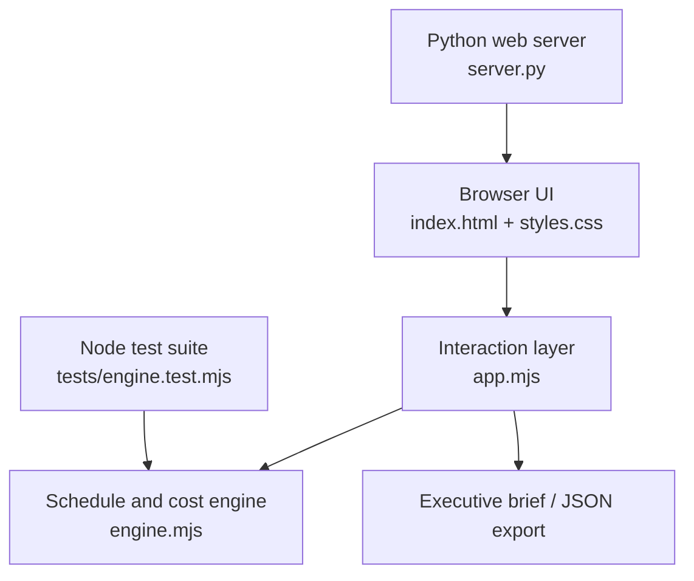

<div align="center">

# DeliveryCommand

### Enterprise Project Recovery Simulator

**Assess delivery challenges. Model recovery options. Make informed program decisions.**

[](#overview)
[](#business-scenario)
[](#model-assumptions--limitations)

**[Overview](#overview)** · **[Business scenario](#business-scenario)** · **[Explore the simulator](#using-deliverycommand)** · **[Technical architecture](#technical-architecture)** · **[Run locally](#run-locally)** · **[Deploy](#deploy-on-render)**

</div>

---

## Overview

**DeliveryCommand** is an interactive enterprise project recovery simulation for analyzing schedule delays, delivery dependencies, budget pressure, and the trade-offs involved in corrective action.

It models a fictional insurance technology modernization program. Users can review the delivery position, select interventions, recalculate the critical path and cost forecast, and export an executive recovery assessment.

> [!NOTE]
> **Scenario transparency:** Every project name, financial value, timeline, work package, and owner is fictional. The calculations are deterministic illustrations—not predictions, confidential client information, or a replacement for an approved integrated master schedule.

## Business scenario

A cross-functional insurance technology modernization program involves external vendors, engineering, system integrations, System Integration Testing (SIT), User Acceptance Testing (UAT), and production cutover.

At the current checkpoint, the program is **10 weeks behind its approved finish date**. Vendor dependencies and integration delays are affecting downstream delivery activities. The objective is to assess the evidence, identify the controlling path, and compare viable recovery strategies without hiding cost and risk exposure.

### Initial delivery snapshot

| Delivery indicator | Starting position | Interpretation |
|:--|--:|:--|
| **Delivery health** |  | Recovery and executive oversight required |
| **Current checkpoint** | Week **20** | Point at which recovery decisions begin |
| **Approved finish** | Week **33** | Original delivery baseline |
| **Forecast finish** | Week **43** | Unmitigated projection |
| **Schedule variance** | **+10 weeks** | Forecast exceeds approved finish |
| **Approved budget** | **$4.00M** | Financial baseline |
| **Actual spend** | **$2.70M** | Spend to the checkpoint |
| **Base remaining forecast** | **$1.60M** | Work still forecast to complete |
| **Estimate at completion** | **$4.30M** | $2.70M actual + $1.60M remaining |
| **Forecast overrun** | **+$300K** | Before recovery intervention costs/savings |

> [!IMPORTANT]
> The original **Week 33 finish and $4.00M budget remain the comparison baselines** throughout the simulation. Recovery options do not silently reset them.

## Using DeliveryCommand

### 1. Diagnose the current position

Review schedule and budget indicators, delivery evidence, and the **RAID register** (Risks, Assumptions, Issues, Dependencies). Distinguish verified constraints from competing explanations.

### 2. Trace the controlling dependencies

Examine the illustrative chain:


The engine recalculates earliest starts and finishes, task float, and the **current critical path** as interventions change activity durations.

### 3. Select recovery interventions

| Intervention | Delivery lever | Trade-off to examine |
|:--|:--|:--|
| **Vendor acceleration** | Expedite upstream deliverables | Vendor capacity and incremental cost |
| **Additional integration capacity** | Address integration bottlenecks | Staffing cost and coordination assumptions |
| **Targeted QA automation** | Shorten suitable repeatable verification activities | Automation investment and achievable coverage |
| **Phased delivery** | Defer defined scope to a later release | Scope approvals and residual obligations |
| **Compressed UAT** | Reduce acceptance-testing duration | Business readiness, defect escape and quality exposure |

Selections can be combined. A recovery action only improves the overall finish forecast when it affects activities that constrain completion.

### 4. Compare the revised forecast

Inspect the updated **completion week**, **remaining variance**, **critical path**, **estimate at completion (EAC)**, **budget gap**, and **quality/governance warnings**. Faster is not automatically better if the revised approach creates unacceptable costs or risks.

### 5. Export the decision record

Generate an **executive recovery brief** or export scenario data as **JSON**. The output summarizes selected interventions, modeled impacts, residual exposure, and recommended management follow-up.

<details>
<summary><strong>Suggested five-minute exploration</strong></summary>

1. Note the initial RED status, Week 43 finish, and $4.30M EAC.
2. Review the RAID register and identify upstream constraints.
3. Enable vendor acceleration and inspect whether the controlling path changes.
4. Compare phased delivery and compressed UAT, paying attention to approval and quality warnings.
5. Combine options, review the financial consequences, and export the executive brief.

</details>

---

## Decision-making principles

| Principle | How the simulation applies it |
|:--|:--|
| **Evidence before blame** | Review schedule facts, issues, and dependencies before assigning corrective actions |
| **Critical-path discipline** | Focus on activities that actually constrain overall completion |
| **Financial transparency** | Show schedule gains alongside intervention costs and EAC changes |
| **Risk-based delivery** | Surface consequences of accelerated work, scope deferral, and compressed testing |
| **Accountability and governance** | Make ownership, approvals, escalation, and follow-up part of the recovery discussion |
| **Baseline integrity** | Compare forecasts with the approved original commitments |

## Technical architecture

The application separates deterministic scheduling/financial logic from the browser interface and lightweight server.



| File | Responsibility |
|:--|:--|
| [`engine.mjs`](engine.mjs) | Dependency scheduling, earliest/latest passes, float, critical path, schedule variance, costs, and warnings |
| [`app.mjs`](app.mjs) | State, interactive scenario selection, visual updates, and report export |
| [`index.html`](index.html) | Accessible application markup |
| [`styles.css`](styles.css) | Responsive presentation |
| [`server.py`](server.py) | Minimal Python HTTP server with no third-party Python dependencies |
| [`tests/engine.test.mjs`](tests/engine.test.mjs) | Node built-in tests covering model behavior and all **32 combinations** of five interventions |
| [`.github/workflows/test.yml`](.github/workflows/test.yml) | CI test execution, when this workflow is included in the repository |

<details>
<summary><strong>How the model works</strong></summary>

- **Schedule:** Builds a finish-to-start dependency graph, calculates earliest start/finish, performs a late pass, derives float, and identifies critical activities.
- **Recovery choices:** Applies modeled changes to activity durations, cost assumptions, and defined scope savings.
- **Financial forecast:** Combines current actuals, base forecast to complete, and intervention cost/savings assumptions.
- **Governance:** Produces warnings for choices that increase risk or require formal approval.
- **Regression tests:** Evaluate the complete 2⁵ = 32 intervention selection space.

</details>

## Run locally

**Requirements:** Python 3; Node.js **20+** for tests; a current web browser.

From the directory containing `server.py`:

```bash
python server.py
```

Open **http://localhost:10000**. Set `PORT` to use a different port.

Run the calculation engine tests:

```bash
node --test tests/*.test.mjs
```

> [!TIP]
> This project does not require a database, credentials, or a paid API to explore the demonstration scenario.

## Deploy on Render

Create a new **Web Service** connected to this repository using these settings:

| Setting | Configuration |
|:--|:--|
| Runtime | **Python 3** |
| Build command | `echo "No dependencies"` |
| Start command | `python server.py` |
| Port | Provided by the `PORT` environment variable |
| Root directory | Repository root, or the directory that contains `server.py` |

Because the recovery calculations run client-side, the interface can also be hosted as a static website with suitable static-file configuration.

## Model assumptions & limitations

> [!WARNING]
> **Illustrative decision support only.** Actual program recovery requires verified work estimates, resource availability, governance approval, contractual constraints, and stakeholder sign-off.

- The base remaining-work estimate is held constant except for explicitly modeled intervention expenses or scope savings.
- The current version does **not** simulate stochastic schedule uncertainty, resource calendars, productivity curves, regulatory review durations, or competing assignments for shared resources.
- Recovery actions are assumptions for scenario exploration—not guaranteed reductions in elapsed time.
- RAG thresholds are defined for this demonstration, not presented as an industry-wide or organizational standard.
- Schedule and financial impacts are always measured against the **original approved baseline**.

## Potential enhancements

Resource capacity modeling · Saved scenario comparison · Probabilistic schedule forecasts · Milestone baseline history · Vendor delivery performance · Audit trails · Configurable governance and approval rules.

<sub>These are possible future enhancements and are not represented as current features.</sub>

---

<div align="center">

**DeliveryCommand** · Enterprise delivery diagnostics, recovery simulation, and decision support

<sub>Independent fictional project · No confidential organizational or client information</sub>

</div>


## Release 1.1 — model validation and language updates

- Scheduling logic now validates unknown predecessors, circular dependencies, and invalid durations.
- Schedule recovery is measured against a computed unmitigated forecast rather than a hardcoded finish week.
- High residual quality exposure keeps delivery health **RED**, even when acceleration improves the date.
- Combined scope compression and testing changes produce additional governance warnings.
- Application copy focuses on project operations, not personal presentations or career use cases.

These are simulation controls, not authorization to change production scope, budget, or acceptance criteria.
